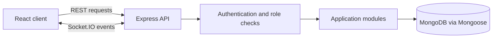

# SkillConnect

SkillConnect is a local services marketplace that helps clients find nearby skilled workers. Clients can post jobs and compare quotes; workers can find matching work, send quotes, and manage accepted jobs. The platform includes separate client, worker, and administrator experiences, persistent MongoDB storage, and live updates through Socket.IO.

## Project Overview

Finding a reliable local professional can involve searching across several services and coordinating availability and pricing through separate channels. SkillConnect brings job posts, worker profiles, quotes, messaging, reviews, notifications, and job progress into one application. Clients describe the work they need, workers discover matching opportunities in their city, and both sides can follow the job through completion.

The project is built as a full-stack JavaScript application. The React frontend uses an Express API for authenticated actions and stored data. MongoDB is the persistent data source, while Socket.IO distributes live events to connected users so changes such as messages, quotes, and worker availability can appear without manually refreshing the page.

## Key Highlights

- Separate experiences for clients, workers, and administrators.
- City- and skill-based discovery for jobs and workers.
- Job quoting, quote acceptance and decline, and worker requoting.
- Job lifecycle tracking, cancellation handling, and dispute management.
- In-app chat, notifications, worker reviews, and ratings.
- JWT access tokens and refresh-token cookies for account sessions.
- MongoDB persistence through Mongoose models.
- Socket.IO events for live updates between connected accounts.
- Responsive React interface built and served during development with Vite.

## System Architecture



The browser loads an initial view of the data through the REST API. MongoDB stores application records. When relevant changes occur, the backend emits Socket.IO events to the users involved; the frontend then updates or reloads the affected data. Socket.IO prefers WebSocket and has a long-polling transport fallback for environments where WebSocket connections are unavailable. That transport fallback is separate from periodic database polling.

## User Workflows

### Client

1. Create a profile with a city and optional area.
2. Post a job with its category, location, budget, description, and timing.
3. Browse nearby workers and review their skills, ratings, and availability.
4. Receive and compare worker quotes, then accept or decline a quote.
5. Message the worker, follow job progress, confirm completion, and leave a review.
6. Open a dispute if a booking needs administrator attention.

### Worker

1. Create a profile with a city, service area, skills, and biography.
2. Set online availability and find jobs matching the worker's city and skills.
3. Send a quote with a price, arrival estimate, and optional note.
4. Respond to quote decisions and submit a new quote after a client declines one, while the job is open.
5. Manage accepted work, message clients, and view earnings and reviews.

### Administrator

- Review platform activity, users, jobs, bookings, payments, and reports.
- Verify workers and manage accounts and reviews.
- Review and resolve disputes.
- Cancel a job or booking when necessary; cancellation status is sent to the affected users.

## Technology Stack

| Layer | Technologies |
| --- | --- |
| Frontend | React, Vite, Axios, Socket.IO Client |
| Backend | Node.js, Express.js, Socket.IO |
| Database | MongoDB, Mongoose |
| Authentication | JWT access tokens and refresh-token cookies |

## Repository Structure

```text
Skillconnect/
├── backend/
│   ├── server.js                 # Express and Socket.IO entry point
│   └── src/
│       ├── common/               # Shared configuration, middleware, and utilities
│       └── modules/              # Auth, clients, workers, jobs, chat, admin, etc.
├── frontend/
│   ├── src/
│   │   ├── components/           # Shared UI and dialogs
│   │   ├── context/              # App state and backend synchronization
│   │   ├── services/             # API clients and Socket.IO connection
│   │   └── views/                # Client, worker, and admin experiences
│   └── vite.config.js
├── .gitignore
└── README.md
```

## Local Development

### Prerequisites

- Node.js and npm
- MongoDB running locally, or a MongoDB Atlas connection string

### 1. Clone the repository

```bash
git clone https://github.com/AH4408/Skillconnect.git
cd Skillconnect
```

### 2. Install and configure the backend

In Terminal 1:

```bash
cd backend
npm install
```

Create `backend/.env` with your local settings:

```env
PORT=5004
NODE_ENV=development
MONGODB_URI=mongodb://127.0.0.1:27017/skillconnect
JWT_ACCESS_SECRET=replace_with_a_long_random_secret
JWT_ACCESS_EXPIRES_IN=15m
JWT_REFRESH_SECRET=replace_with_a_different_long_random_secret
JWT_REFRESH_EXPIRES_IN=7d
FRONTEND_URL=http://localhost:5173
```

The example MongoDB URI uses a local MongoDB service. To use MongoDB Atlas, substitute your Atlas connection string. Generate separate values for the JWT secrets. On macOS or Linux, you can generate a random value with:

```bash
openssl rand -base64 48
```

Start the backend:

```bash
npm start
```

The API runs at `http://localhost:5004`. Check `http://localhost:5004/health` to confirm it is running.

### 3. Install and run the frontend

In Terminal 2, from the repository root:

```bash
cd frontend
npm install
cp .env.example .env
npm run dev
```

Open the local URL printed by Vite, usually `http://localhost:5173`.

The frontend example environment file points to the local backend on port `5004`. If you use another backend port, update `VITE_API_BASE_URL` and `VITE_SOCKET_URL` in `frontend/.env` to match. Keep the frontend, backend, and MongoDB service running while using the app.

## Environment Variables

### Backend (`backend/.env`)

| Variable | Purpose |
| --- | --- |
| `PORT` | HTTP and Socket.IO server port. The included frontend defaults use `5004`. |
| `NODE_ENV` | Runtime mode. |
| `MONGODB_URI` | MongoDB connection string. |
| `JWT_ACCESS_SECRET` | Secret used to sign access tokens. |
| `JWT_ACCESS_EXPIRES_IN` | Access-token lifetime, such as `15m`. |
| `JWT_REFRESH_SECRET` | Separate secret used to sign refresh tokens. |
| `JWT_REFRESH_EXPIRES_IN` | Refresh-token lifetime, such as `7d`. |
| `FRONTEND_URL` | Frontend origin allowed for CORS and Socket.IO. |

### Frontend (`frontend/.env`)

| Variable | Purpose |
| --- | --- |
| `VITE_API_BASE_URL` | Backend REST API URL, including `/api`. |
| `VITE_SOCKET_URL` | Backend origin used for Socket.IO. |
| `VITE_USE_BACKEND` | Set to `true` to use the backend-backed application. |

Vite includes `VITE_*` values in browser code. Do not store passwords, database credentials, JWT secrets, or other private keys in frontend variables.

## API Areas

API routes are mounted under `/api`. Role-protected routes require a valid access token and appropriate permissions.

| Prefix | Purpose |
| --- | --- |
| `/api/auth` | Register, sign in, refresh a session, sign out, and retrieve the current account. |
| `/api/client` | Client profile and dashboard data. |
| `/api/workers` | Worker search and profile management. |
| `/api/jobs` | Create, find, update, assign, track, and cancel jobs. |
| `/api/bookings` | Submit quotes, accept or decline quotes, and advance booking status. |
| `/api/chats` | Create conversations, retrieve and send messages, and mark chats read. |
| `/api/notifications` | Retrieve notifications and mark them read. |
| `/api/reviews` | Create reviews and retrieve worker reviews. |
| `/api/disputes` | Create, review, and resolve disputes. |
| `/api/payments` | View payment records, record a payment, and process an administrator refund. |
| `/api/admin` | Administrator dashboard, account management, and operational reports. |

The health check is `GET /health` and does not require authentication.

## Real-Time Updates

Socket.IO authenticates connections using the user's access token and places connected users in server-controlled rooms. Events cover worker presence, job availability, bookings and quotes, chat messages, notifications, and administrator updates.

The frontend first fetches current data through REST. It then responds to relevant Socket.IO events and reconnections by updating or fetching the affected data again. There is no recurring job-data polling loop. Socket.IO's long-polling option is only a connection transport fallback when WebSocket cannot be used; it does not mean every transport request performs a MongoDB query.

## Engineering Decisions

### Why React and Vite?

React provides reusable components for the distinct client, worker, and administrator screens. Vite provides the frontend development server and creates the optimized static production build.

### Why Express and MongoDB?

Express exposes the API and applies authentication and role checks before module operations. MongoDB with Mongoose stores users, profiles, jobs, quotes, bookings, messages, reviews, notifications, and other application records.

### Why Socket.IO?

The application needs to show changes such as a new message or a worker going offline without requiring a user to reload the page. Socket.IO lets the backend send events to connected users and supports a fallback transport for restrictive networks.

## Build

Build the frontend for production:

```bash
cd frontend
npm run build
```

Vite writes the generated site to `frontend/dist/`. The build output is generated locally and should not be committed.

## Deployment Notes and Current Limitations

- GitHub stores the source code; it does not run the complete application. The backend needs a Node.js host that supports persistent Socket.IO connections, and the app needs an accessible MongoDB database.
- GitHub Pages can host a static frontend for a temporary visual demo, but it cannot host the Express API or MongoDB. Backend-dependent features require a separately deployed backend and database.
- For a full deployment, set production values for the frontend API and Socket.IO URLs and configure the backend's `FRONTEND_URL` for the deployed frontend origin.
- Use HTTPS, strong unique secrets, and a managed MongoDB deployment in production. Never reuse development credentials.
- Payment records currently use a demo transaction ID; no external payment gateway is integrated.
- Email verification delivery is currently disabled in the registration service and must be configured before relying on that flow in production.
- The backend currently provides an `npm start` script; a separate development/watch script is not configured.

## Troubleshooting

### The frontend cannot reach the API

Confirm MongoDB and the backend are running. Open `http://localhost:5004/health`, and check that `frontend/.env` points to the correct API and Socket.IO URLs.

### MongoDB fails to connect

Start the local MongoDB service or verify that `MONGODB_URI` points to a reachable database. For Atlas, check the connection string and network access settings.

### A worker does not see a job

Check that the worker profile city matches the job city and that the worker has a skill matching the job category. Also confirm the job is open and the backend is connected to the expected database.

### Changes do not appear until reload

Confirm both accounts are connected to the same backend, the backend is running, and the browser has a valid authenticated Socket.IO connection. Reloading fetches a fresh REST snapshot, but live updates require the socket connection to remain active.

## Security

- Do not commit `.env` files, database credentials, JWT secrets, SMTP passwords, or production tokens.
- Root and backend `.gitignore` rules exclude local environment files, generated dependencies, and build output.
- Store production secrets in the hosting provider's secret manager.
- Administrator accounts are platform accounts and cannot be created through public registration.

## Future Improvements

- Integrate a real payment gateway.
- Configure and verify email delivery for account verification and notifications.
- Add automated backend and frontend test coverage.
- Improve deployment automation for the frontend and backend.
- Add production monitoring, structured logging, and backup procedures.
